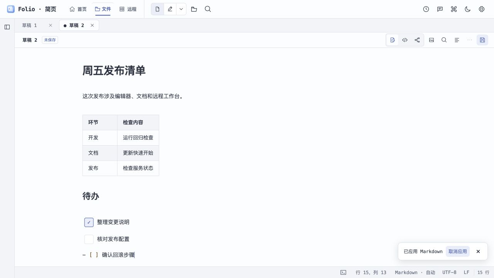
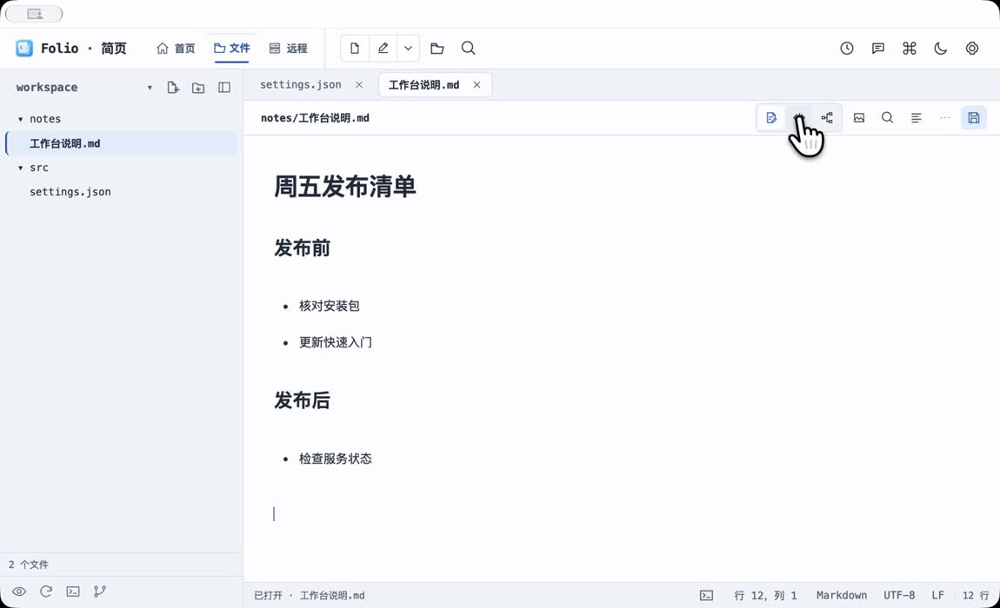
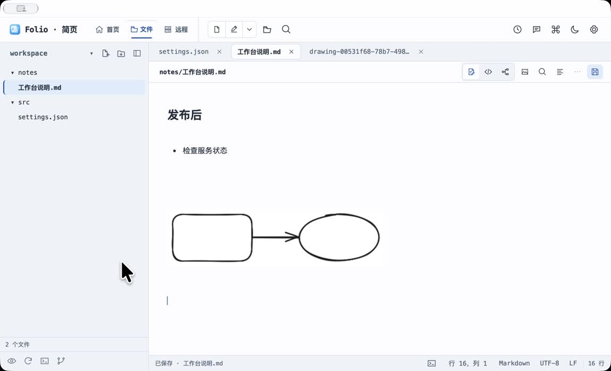
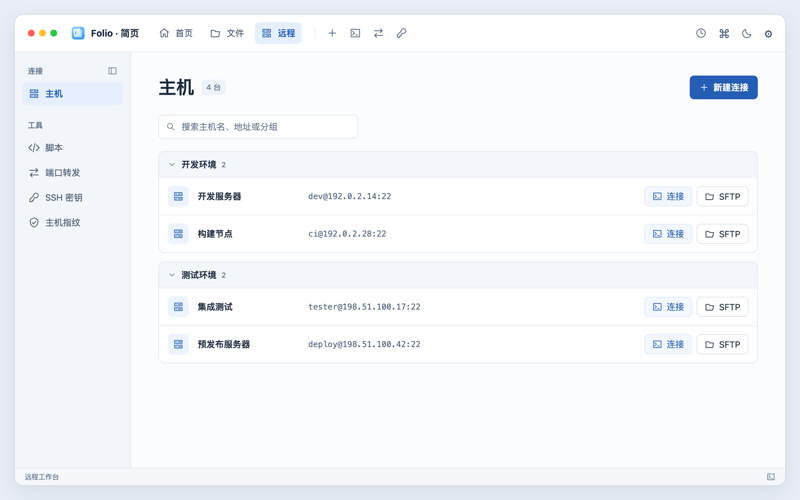
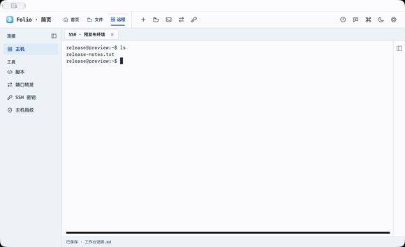
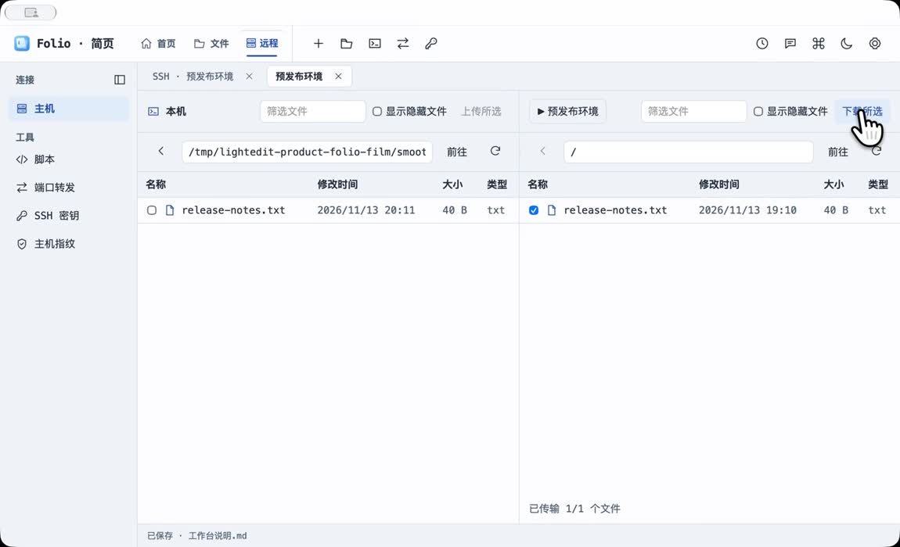

  
  <h1>Folio</h1>
  
A local workspace for Markdown, code, reading notes, and SSH.

  
<a href="https://bujiuzhi.github.io/Folio/en.html">Website</a> · <a href="https://github.com/bujiuzhi/Folio/releases/tag/v0.1.6">Download v0.1.6</a> · <a href="https://bujiuzhi.github.io/Folio/folio.mp4?v=promo2">53-second product film</a>

  
<a href="README.md">中文</a> · <a href="README.en.md">English</a>

## Download and install

| Platform | Installer | Installation |
| --- | --- | --- |
| macOS | [Apple silicon](https://github.com/bujiuzhi/Folio/releases/download/v0.1.6/Folio_0.1.6_aarch64.dmg) · [Intel](https://github.com/bujiuzhi/Folio/releases/download/v0.1.6/Folio_0.1.6_x64.dmg) | Open the DMG and drag Folio into Applications. |
| Windows x64 | [Installer](https://github.com/bujiuzhi/Folio/releases/download/v0.1.6/Folio_0.1.6_x64-setup.exe) | Run the downloaded EXE. |
| Linux x64 | [DEB](https://github.com/bujiuzhi/Folio/releases/download/v0.1.6/Folio_0.1.6_amd64.deb) · [AppImage](https://github.com/bujiuzhi/Folio/releases/download/v0.1.6/Folio_0.1.6_amd64.AppImage) | Install the DEB with your package manager, or make the AppImage executable and run it. |

For v0.1.1 and later, go to Preferences → Appearance → Check for Updates. If you have the v0.1.0 preview, download an installer.

## Six things to try

<table>
  <tr><th width="33%">Paste and format</th><th width="33%">Live Markdown</th><th width="33%">Excalidraw</th></tr>
  <tr><td></td><td></td><td></td></tr>
  <tr><td>Paste Markdown, JSON, YAML, or code into a new draft. Folio renders Markdown or highlights recognized syntax. Change the format in the lower-right corner, or use Format to fix indentation.</td><td>Headings, tables, and checklists update as you type. Switch to source or mind map view from the same note.</td><td>Open a canvas from the toolbar or insert a drawing into Markdown. Save it to see it in the note.</td></tr>
</table>

<table>
  <tr><th width="33%">Manage hosts</th><th width="33%">SSH terminal</th><th width="33%">SFTP transfers</th></tr>
  <tr><td></td><td></td><td></td></tr>
  <tr><td>Find saved hosts in Remote by name, address, or group. Open SSH or SFTP from the host row.</td><td>Click Connect to open a terminal tab. Save commands you use often as scripts.</td><td>Open separate SFTP tabs for different hosts and upload or download files.</td></tr>
</table>

[Browse all six screenshots on the website](https://bujiuzhi.github.io/Folio/en.html#workbench)

## Feature list

| Feature | How it works |
| --- | --- |
| Drafts and code | Paste into a new draft for format detection and syntax highlighting. The editor also supports formatting, find and replace, line jumps, and encoding changes. |
| Markdown and drawing | Open Markdown in live layout, source, or mind map view. Open Excalidraw from the toolbar or add a canvas to a note. |
| SSH and SFTP | Group hosts and save scripts in Remote. Open SSH and SFTP tabs for multiple hosts at the same time. |
| Files and Git | Open a folder and search by name or content. Review changes or open earlier versions. Stage, commit, pull, and push in Git workspaces. |
| Office and mind maps | Preview Word, Excel, images, and XMind. Drag the XMind canvas to pan or scroll to zoom. Edit plain Word paragraphs, existing ordinary Excel cells, and XMind topic titles. |
| PDF and EPUB reading | Select text to add a note or save a highlight. Click a highlight to open its note in the sidebar, or jump back from the note to the passage. Export highlights to XMind by page or chapter. |
| Markdown export | Choose Word, HTML, PDF, or ZIP with images from Document Options → Export. Hover over an image in the editor to set its width. |
| Local terminal and SSH tunnels | Start a shell in the project folder. Manage local, remote, and dynamic SOCKS forwarding rules in Remote. |
| AI chat | Connect a compatible model API and ask questions beside the editor. Review suggested file changes before applying them. |

Open the bundled reading examples to try the included notes, highlights, and mind maps. Sync your workspace folder to take reading annotations, theme, and fonts with you in `.folio`. Use the original passphrases to unlock encrypted SSH and model settings.

Folio uses the system WebView, loads formula and diagram rendering on demand, and indexes files in the background.

## What's new in v0.1.6

- Use Typora-style shortcuts in both Markdown editing modes. Rebind, clear, or reset them in Preferences → Keyboard Shortcuts. Folio names the command that already uses a conflicting key.
- Copy Markdown code blocks from the button in the top-right corner.
- Drag folders to reorder or move them in the file tree, or move them to Trash from the context menu.
- Open and save files or choose folders in Folio's own picker. Confirmation dialogs and focus indicators now share the same style.
- Reset Examples clears the Examples folder and recreates the bundled files. Files outside the folder and reading annotations are preserved.

[Release notes](https://github.com/bujiuzhi/Folio/releases/tag/v0.1.6) · [SHA-256 checksums](https://github.com/bujiuzhi/Folio/releases/download/v0.1.6/SHA256SUMS.txt)

## Feedback

Open a [bug report](https://github.com/bujiuzhi/Folio/issues/new?template=bug-report.md) or a [feature request](https://github.com/bujiuzhi/Folio/issues/new?template=feature-request.md).
