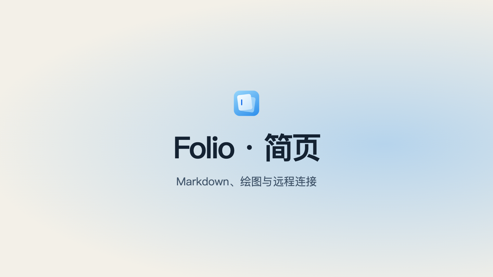

[中文](README.md) · [English](README.en.md)

  
  <h1>Folio · 简页</h1>
  
<strong>本地笔记与代码工作台</strong>

  
写 Markdown 时即时排版，贴进草稿的代码可以格式化。项目文件、SSH 终端和多个 SFTP 标签都在同一个窗口。

  

    <a href="https://github.com/bujiuzhi/Folio/releases/download/v0.1.4/Folio_0.1.4_aarch64.dmg"><strong>下载 macOS Apple 芯片版</strong></a>
    · <a href="https://github.com/bujiuzhi/Folio/releases/download/v0.1.4/Folio_0.1.4_x64-setup.exe"><strong>下载 Windows 版</strong></a>
    · <a href="https://bujiuzhi.github.io/Folio/">官网</a>
    · <a href="https://bujiuzhi.github.io/Folio/folio.mp4">观看 54 秒演示</a>
    · <a href="https://github.com/bujiuzhi/Folio/releases">发行记录</a>
  

  
v0.1.4 · macOS / Windows / Linux

  

## 在 Folio 里做什么

<table>
  <tr>
    <th width="33%">写笔记</th>
    <th width="33%">画流程</th>
    <th width="33%">连接服务器</th>
  </tr>
  <tr>
    <td></td>
    <td></td>
    <td></td>
  </tr>
  <tr>
    <td>在排版、源码和思维导图之间切换，直接编辑表格和待办。</td>
    <td>从笔记插入 Excalidraw 画布，画完保存，回到正文查看预览。</td>
    <td>核对主机指纹后打开 SSH 终端。给不同服务器分别开 SFTP 标签，在本机和远端之间传文件。</td>
  </tr>
</table>

打开项目文件夹后，可以按文件名或正文搜索，给代码和配置做格式化，也可以在标签页查看 Word、Excel 和图片，macOS 也能预览 PDF。文件被外部修改时，可以先看差异再决定怎么保存。

[查看功能截图](https://bujiuzhi.github.io/Folio/#workbench)

## v0.1.4 更新

- 更新窗口显示下载进度，下载期间可以取消。
- 修复 Windows 从文件树打开终端时的路径问题。
- 文件树用带斜杠的眼睛标记隐藏文件未显示的状态。
- AI 回复支持 Markdown。开启工作区后，读取文件时省去逐次确认，创建或修改文件仍需确认。

## 下载与安装

1. 按芯片下载 DMG。选 [Apple 芯片](https://github.com/bujiuzhi/Folio/releases/download/v0.1.4/Folio_0.1.4_aarch64.dmg) 或 [Intel](https://github.com/bujiuzhi/Folio/releases/download/v0.1.4/Folio_0.1.4_x64.dmg)。
2. 打开 DMG，将 **Folio.app** 拖到「应用程序」。
3. 打开 Folio，选择一个本地文件夹，或先新建草稿。

[下载 DMG](https://github.com/bujiuzhi/Folio/releases/download/v0.1.4/Folio_0.1.4_aarch64.dmg) · [查看发行说明与校验文件](https://github.com/bujiuzhi/Folio/releases/tag/v0.1.4)

**Windows x64**：下载并运行 [NSIS 安装程序](https://github.com/bujiuzhi/Folio/releases/download/v0.1.4/Folio_0.1.4_x64-setup.exe)。

**Linux x64**：下载 [AppImage](https://github.com/bujiuzhi/Folio/releases/download/v0.1.4/Folio_0.1.4_amd64.AppImage) 或适用于 Debian / Ubuntu 的 [DEB](https://github.com/bujiuzhi/Folio/releases/download/v0.1.4/Folio_0.1.4_amd64.deb)。

已安装 v0.1.1 或更新版本时，可在「偏好设置 → 外观 → 检查更新」下载并安装新版。v0.1.0 预览版需先手动安装一次。
