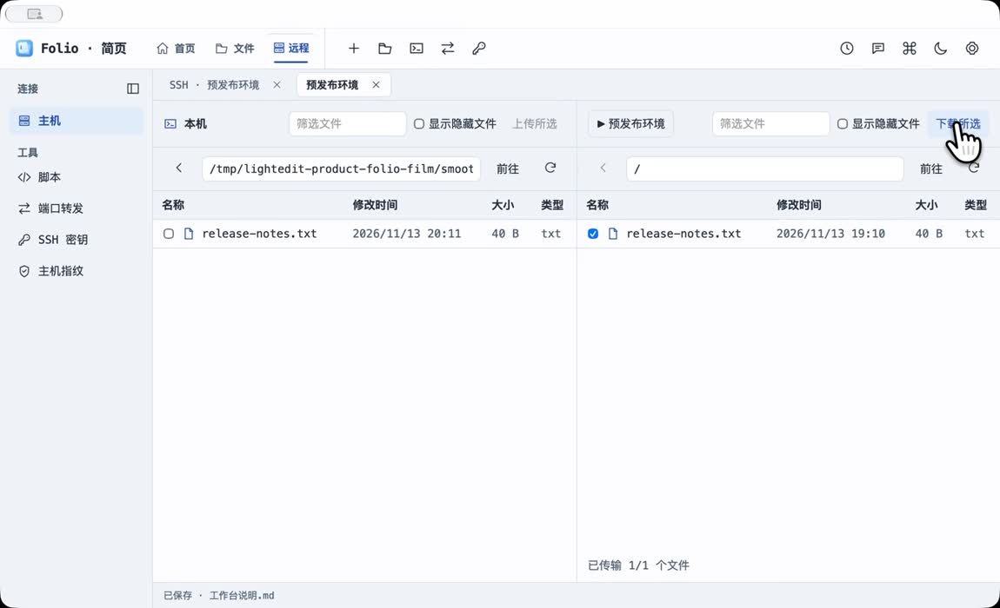

  
  <h1>Folio · 简页</h1>
  
在同一个窗口写 Markdown、改代码、用 SSH 连服务器。

  
<a href="https://bujiuzhi.github.io/Folio/">官网</a> · <a href="https://github.com/bujiuzhi/Folio/releases/tag/v0.1.5">下载 v0.1.5</a> · <a href="https://bujiuzhi.github.io/Folio/folio.mp4">54 秒操作演示</a>

  
<a href="README.md">中文</a> · <a href="README.en.md">English</a>

## 下载与安装

| 平台 | 安装包 | 怎么装 |
| --- | --- | --- |
| macOS | [Apple 芯片](https://github.com/bujiuzhi/Folio/releases/download/v0.1.5/Folio_0.1.5_aarch64.dmg) · [Intel](https://github.com/bujiuzhi/Folio/releases/download/v0.1.5/Folio_0.1.5_x64.dmg) | 打开 DMG，把 Folio 拖进「应用程序」。 |
| Windows x64 | [安装程序](https://github.com/bujiuzhi/Folio/releases/download/v0.1.5/Folio_0.1.5_x64-setup.exe) | 运行下载的 EXE。 |
| Linux x64 | [DEB](https://github.com/bujiuzhi/Folio/releases/download/v0.1.5/Folio_0.1.5_amd64.deb) · [AppImage](https://github.com/bujiuzhi/Folio/releases/download/v0.1.5/Folio_0.1.5_amd64.AppImage) | 用包管理器安装 DEB，或给 AppImage 执行权限后直接运行。 |

已安装 v0.1.1 或更新版本，可到「偏好设置 → 外观 → 检查更新」升级。v0.1.0 预览版请下载安装包。

## 工作台

<table>
  <tr><th width="33%">粘贴识别</th><th width="33%">Markdown 排版</th><th width="33%">Excalidraw 绘图</th></tr>
  <tr><td></td><td></td><td></td></tr>
  <tr><td>点「新建草稿」后粘贴 Markdown、JSON 或代码。识别后自动排版或高亮，缩进可用「格式化」整理。</td><td>标题、表格和待办随编辑更新。也可以切到源码或思维导图。</td><td>从工具栏打开画布，或在 Markdown 中插入绘图。保存后回到正文看图。</td></tr>
</table>

<table>
  <tr><th width="33%">主机管理</th><th width="33%">SSH 终端</th><th width="33%">SFTP 传文件</th></tr>
  <tr><td></td><td></td><td></td></tr>
  <tr><td>在「远程」按名称、地址或分组找主机，从同一行打开 SSH 或 SFTP。</td><td>点主机旁的「连接」打开终端标签。常用命令可以存成脚本。</td><td>为不同主机打开各自的 SFTP 标签，在本机和服务器之间上传或下载。</td></tr>
</table>

[在官网切换查看六张截图](https://bujiuzhi.github.io/Folio/#workbench)

## 其他功能

| 功能 | 用法 |
| --- | --- |
| 文件与 Git | 打开文件夹后按名称或正文搜索。保存前可查看文件差异，也能查看历史版本。在 Git 工作区可暂存、提交、拉取和推送。 |
| Office 与导图 | 预览 Word、Excel、图片和 XMind。打开 XMind 后可拖动画布、滚轮缩放。可编辑 Word 普通正文、Excel 已有的普通单元格和 XMind 主题标题。 |
| PDF 和 EPUB 阅读 | 选中文字划线或记笔记，点高亮回看。可以按页或章节导出为 XMind。 |
| Markdown 导出 | 在「文档选项 → 导出」选择 Word、网页、PDF 或含图片的 ZIP。鼠标移到正文图片上可以设置宽度。 |
| 本地终端与 SSH 隧道 | 从项目目录启动 Shell，在远程工作台管理本地、远程和动态 SOCKS 转发规则。 |
| AI 对话 | 配置兼容的模型 API 后，在编辑器旁提问。先看建议的文件差异，再决定是否应用。 |

Folio 用系统 WebView 显示界面，公式和图表按需加载，文件索引在后台建立。

## v0.1.5 更新

- PDF、EPUB 支持划线、笔记、书签和 XMind 导出。
- 草稿支持识别带注释的 YAML，也可从右下角手动切换格式。
- 工作区设置可初始化示例，原示例内容会备份。
- 修复部分 Windows 设备的 WebView2 启动问题。

[发行说明与校验文件](https://github.com/bujiuzhi/Folio/releases/tag/v0.1.5)
